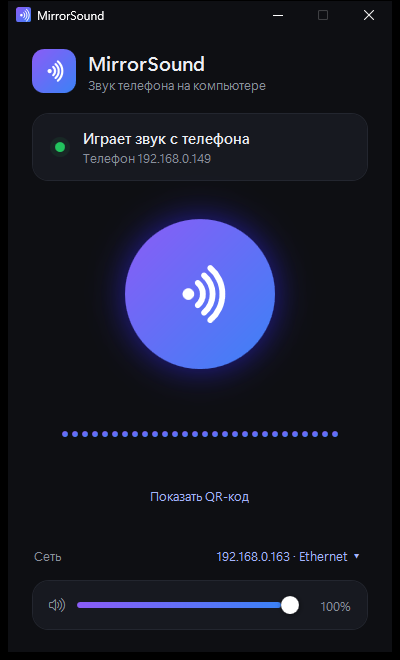

# MirrorSound

Звук с Android-телефона на компьютер с Windows или Linux по Wi‑Fi. Без кабеля, без режима разработчика: отсканировали QR-код — и всё, что играет на телефоне, звучит из колонок ПК.

<p align="center"></p>

## Как пользоваться

1. Установите программу на компьютер — всё есть в [Releases](https://github.com/uto4e4ka/MirrorSound/releases):
   - **Windows:** скачайте **MirrorSound-Setup.exe** и установите. Установщик сам откроет программе доступ в брандмауэре и, если хотите, добавит её в автозапуск.
   - **Linux:** скачайте **MirrorSound-linux-x64.tar.gz**, распакуйте и запустите `sh MirrorSound/install.sh` (root не нужен). Программа появится в меню приложений.

   Ставить .NET отдельно не нужно. После запуска в окне появится QR-код.
2. Наведите на него камеру телефона. Откроется страничка с компьютера:
   - в первый раз нажмите «Скачать приложение» и установите его;
   - затем нажмите «Подключить».
3. Подтвердите на телефоне запрос на запись звука (выберите «Весь экран»).

Дальше достаточно открыть приложение и нажать большую кнопку — или «Сканировать QR».

Телефон и компьютер должны быть в одной сети.

Программа живёт в трее: крестик только прячет окно, а выйти можно через меню значка в трее. Громкость и выбранная сеть запоминаются, а автозапуск включается переключателем в окне.

## Ограничения

- Android 10 и новее (используется `AudioPlaybackCapture`).
- Некоторые приложения запрещают захват своего звука; звук звонков захватить нельзя.
- Задержка — около 60–150 мс, для музыки и видео незаметно, для игр — ощутимо.
- Linux: нужен PulseAudio или PipeWire (есть почти в любом десктопном дистрибутиве), x86‑64. Значок в трее показывается там, где он поддерживается (KDE, Cinnamon, XFCE; в GNOME — с расширением AppIndicator). Если трея нет, окно открывается повторным запуском MirrorSound из меню. Если включён брандмауэр (ufw/firewalld), откройте порты ниже — `install.sh` подскажет команды.

## Как это устроено

| Часть | Что делает |
|---|---|
| `android/` | Приложение на Java без лишних зависимостей. Захватывает звук через MediaProjection + AudioPlaybackCapture и шлёт его по TCP (PCM 48 кГц, стерео). QR сканируется через Google Code Scanner, без доступа к камере. |
| `shared/` | Общий код для Windows и Linux: приём потока и контроль задержки, автопоиск, страничка с APK для QR, выбор сети, настройки. |
| `pc/` | Windows: WPF-приложение на .NET 10, звук через WASAPI (NAudio), трей, установщик. |
| `linux/` | Linux: приложение на Avalonia, звук через PulseAudio/PipeWire (`libpulse-simple`), трей, автозапуск через `~/.config/autostart`. |

Порты: `47800/tcp` — звук, `47801/udp` — автопоиск компьютера в сети, `47802/tcp` — страничка для QR.

## Сборка

Нужны JDK 17+, Android SDK и .NET 10 SDK.

```bash
cd android
./gradlew assembleDebug
```

```bash
cd pc
dotnet publish -c Release -r win-x64 --self-contained false -p:PublishSingleFile=true -o ../bin/pc
```

Собирайте Android первым: APK встраивается в MirrorSound.exe, чтобы компьютер мог отдать его телефону.

Linux-архив (собирается и на Windows, нужен Python 3):

```bash
powershell -ExecutionPolicy Bypass -File installer/build-linux.ps1
```

Windows-установщик целиком (APK → exe со встроенным .NET → MirrorSound-Setup.exe через [Inno Setup 6](https://jrsoftware.org/isinfo.php)):

```bash
powershell -ExecutionPolicy Bypass -File installer/build-installer.ps1
```
